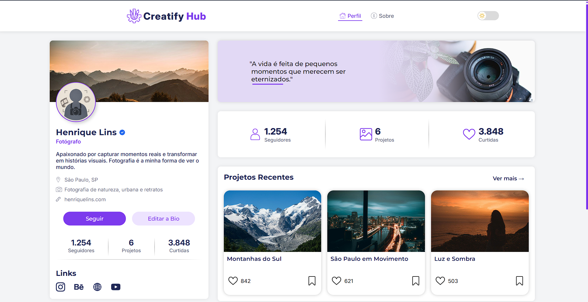

# 🎨 Creatify Hub

Uma rede social fictícia voltada para profissionais criativos, como designers gráficos, fotógrafos e ilustradores.

O projeto foi desenvolvido como parte da minha jornada prática de desenvolvimento web, com foco na construção de uma interface moderna, responsiva e interativa.

## 📸 Preview



## 🌐 Projeto Online

🔗 **Acesse o projeto:** [Visualizar Projeto](https://henrique-aragao.github.io/creatify-hub-profile/)


## 📖 Sobre o projeto

O **Creatify Hub** simula uma plataforma onde profissionais criativos podem apresentar seus trabalhos, informações profissionais e projetos recentes.

O projeto possui duas páginas principais:

- **Perfil** — apresentação do profissional, informações, estatísticas e projetos.
- **Sobre** — apresentação da plataforma, seu propósito e público-alvo.

A interface também conta com recursos de interação desenvolvidos com JavaScript, incluindo edição das informações do perfil, curtidas, salvamentos, contador de curtidas, menu hambúrguer e alternância entre tema claro e escuro.

## ✨ Funcionalidades

### 👤 Perfil

- Exibição de foto, nome, profissão, localização e área de atuação.
- Edição das informações do perfil.
- Contador de seguidores, projetos e curtidas.
- Curtidas nos projetos.
- Salvamento de projetos.
- Contador de curtidas atualizado através de JavaScript.
- Botão de seguir com alteração de estado.
- Exibição de projetos recentes.
- Botão **Ver mais / Ver menos** para exibir outros projetos.

### 🌙 Interface

- Tema claro.
- Tema escuro.
- Menu hambúrguer para dispositivos menores.
- Layout responsivo para celular, tablet e desktop.
- Feedback visual nas interações.
- Navegação entre as páginas Perfil e Sobre.

### ♿ Acessibilidade

- Uso de elementos HTML semânticos.
- Identificação adequada de elementos interativos.
- Estados de `:focus-visible` para navegação por teclado.
- Textos alternativos em imagens e ícones quando necessário.
- Botões e links preparados para interação por diferentes dispositivos.

## 🛠️ Tecnologias

- HTML5
- CSS3
- JavaScript
- Google Fonts

### Recursos utilizados

- CSS Variables
- Flexbox
- Media Queries
- Pseudo-classes
- `localStorage`
- Manipulação do DOM
- Eventos JavaScript

## 📱 Responsividade

O Creatify Hub foi desenvolvido para funcionar em diferentes tamanhos de tela.

O layout possui adaptações específicas para:

- 🖥️ Desktop
- 💻 Tablet
- 📱 Celular

No celular, a navegação principal é adaptada para um menu hambúrguer, facilitando o acesso às páginas em telas menores.

## 🎨 Identidade visual

A interface utiliza uma combinação de roxo e amarelo como cores principais, criando uma identidade visual voltada ao universo criativo.

### Tema claro

- **Primária:** `#7C3AED`
- **Primária — Hover:** `#5928AD`
- **Secundária:** `#FACC15`
- **Fundo:** `#F3F4F6`
- **Fundo branco:** `#FFFFFF`

### Tipografia

- **Montserrat** — títulos e elementos de destaque.
- **Inter** — textos e informações gerais.

O projeto também possui um tema escuro desenvolvido para manter a identidade visual e melhorar a experiência em ambientes com pouca iluminação.

## 📂 Estrutura do projeto

```text
creatify-hub-profile/
│
├── assets/
│   ├── css/
│   │   ├── variables.css
│   │   ├── style.css
│   │   ├── responsive.css
│   │   └── dark-mode.css
│   │
│   ├── icons/
│   ├── img/
│   └── preview/
│
├── js/
│   ├── script.js
│   └── tema.js
│
├── index.html
├── sobre.html
└── README.md
```
## 👨‍💻 Autor

Desenvolvido por **Henrique Lins**.

- LinkedIn: [Henrique Lins](https://www.linkedin.com/in/henrique-lins-aragao/)